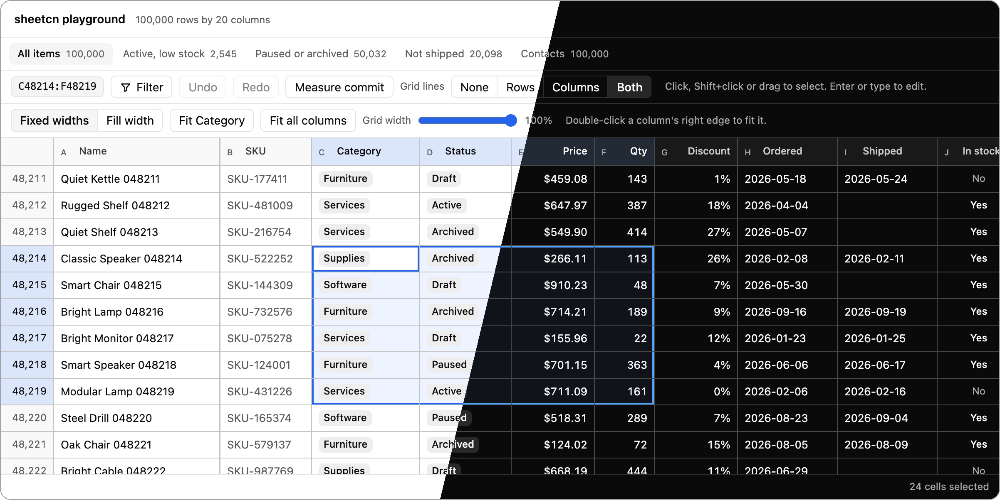
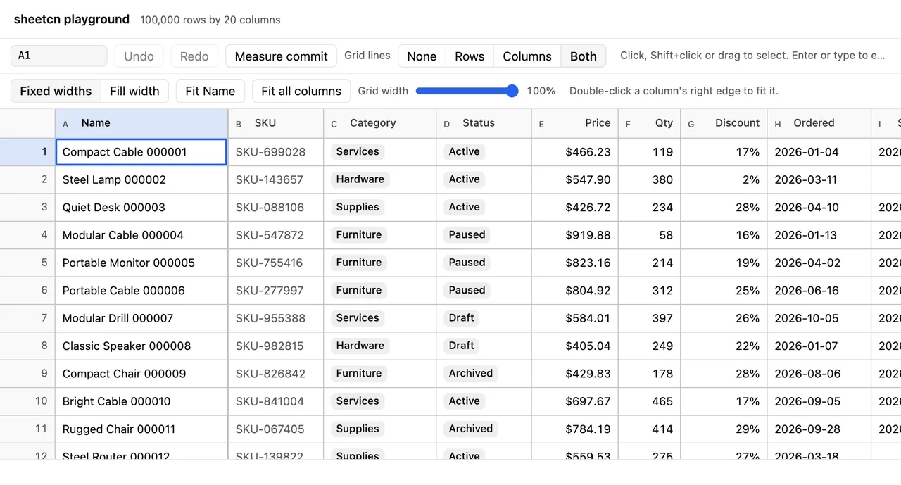
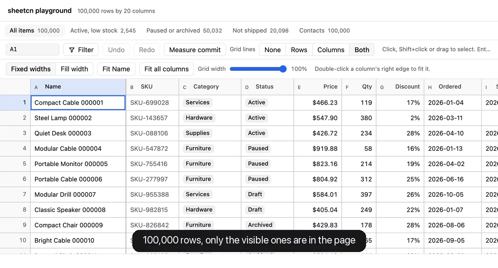
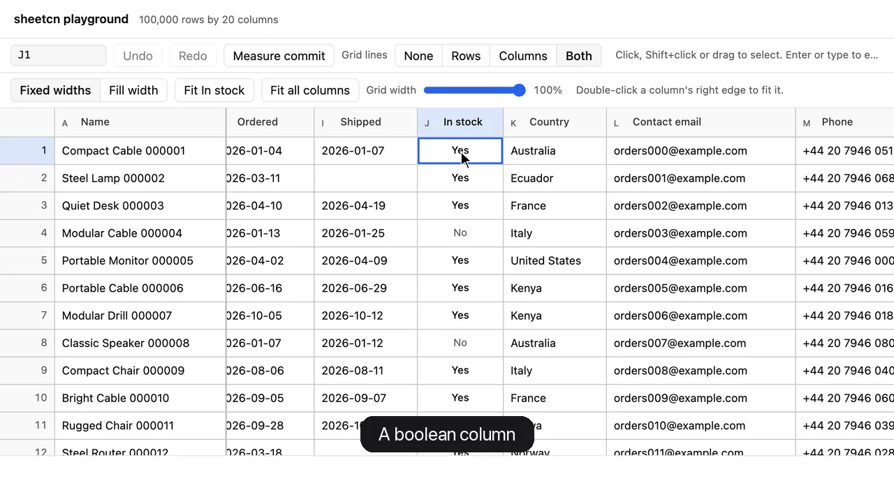
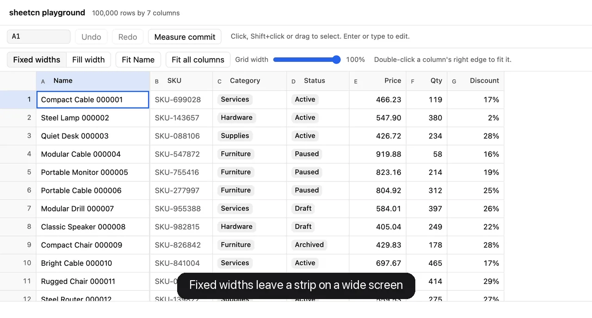

<p align="center">
  
</p>

<h1 align="center">sheetcn</h1>

<p align="center">
  A customizable spreadsheet and data-table component for React and shadcn/ui.<br/>
  Built on <a href="https://tanstack.com/table">TanStack Table</a> and <a href="https://tanstack.com/virtual">TanStack Virtual</a>. The grid views will install from a <a href="https://ui.shadcn.com/docs/registry">shadcn registry</a>.
</p>

<p align="center">
  <a href="https://github.com/Fredehagelund92/sheetcn/stargazers"></a>
  <a href="https://github.com/Fredehagelund92/sheetcn/actions/workflows/ci.yml"></a>
  <a href="LICENSE"></a>
</p>

<p align="center">
  <a href="#see-it-work">Demos</a> ·
  <a href="#numbers">Numbers</a> ·
  <a href="#table-and-sheet">Table and sheet</a> ·
  <a href="#column-sizing">Column sizing</a> ·
  <a href="#status">Status</a> ·
  <a href="#development">Development</a> ·
  <a href="apps/playground">Playground</a>
</p>

## Features

- **Spreadsheet selection**: click, drag, Shift to extend, Ctrl or Cmd to add ranges, whole rows and columns from the headers. Pointer events, so mouse, pen and touch all work.
- **Spreadsheet keys**: arrows, jumps to the edge of the data, paging, Enter or typing to edit, Tab and Enter to commit and move, Escape to cancel, undo and redo.
- **Typed columns**: text, number, date, select and boolean, each with parse, format and validate. Nothing is guessed: `1,5` and `3/4/2026` are rejected, not read one way or the other.
- **One change for every mutation**: each edit, toggle, clear, undo and redo reaches your app as one `Change`, so saving it is one function.
- **Undo and redo**: transactions are single steps, and a burst of typing undoes at once.
- **Column sizing**: fixed widths, or fill the grid's width and scroll when the columns do not fit. Double-click a column's edge to fit it to its content.
- **Fast at 100,000 rows**: rows and columns are virtualized, and a one-cell commit rebuilds only the row it changed.
- **Controlled or not**: the sheet can keep the rows, or your state can, with `applyChange`.
- **Headless core**: the schema, values, store, selection and key map are plain TypeScript, with no React and no DOM.

## See it work

Every frame below is a screenshot of the [playground](apps/playground), at 100,000 rows by 20 columns. [`scripts/readme-assets.py`](scripts/readme-assets.py) captures them again.

### Select with the pointer



### Move and edit with the keyboard


### Scroll 100,000 rows



### Toggle a boolean column



### Fill the width and fit columns



## Numbers

All measured at 100,000 rows by 20 columns, and recorded with the change that added them.

| What                                                   | Measured                                                           | Gate        | Source                                                                                                                       |
| ------------------------------------------------------ | ------------------------------------------------------------------ | ----------- | ---------------------------------------------------------------------------------------------------------------------------- |
| One-cell commit in the core                            | median 0.093 ms (0.109 ms controlled)                              | under 1 ms  | [`commit-budget.test.ts`](packages/core/test/commit-budget.test.ts), [#1](https://github.com/Fredehagelund92/sheetcn/pull/1) |
| One-cell commit to paint, in the browser               | median 2.0 to 3.8 ms                                               | under 5 ms  | [`bench.ts`](apps/playground/src/bench.ts), [#2](https://github.com/Fredehagelund92/sheetcn/pull/2)                          |
| The same, with the CPU slowed 4 times                  | median 7.1 to 9.5 ms                                               | under 25 ms | [#2](https://github.com/Fredehagelund92/sheetcn/pull/2)                                                                      |
| Rows rendered again per one-cell commit                | 1                                                                  |             | [#2](https://github.com/Fredehagelund92/sheetcn/pull/2)                                                                      |
| One-cell commit through `useSheet`, test DOM, no paint | 0.36 to 0.39 ms, against 38 to 50 ms with TanStack's own row model |             | [#2](https://github.com/Fredehagelund92/sheetcn/pull/2)                                                                      |
| Scroll, three rows a frame, in the browser             | 60 fps; work per frame median 2.7 to 3.3 ms, none over 16.7 ms     | 60 fps      | [`bench.ts`](apps/playground/src/bench.ts)                                                                                   |
| Fit one column to its content, in the browser          | 3 to 7 ms; all 20 columns in 35 ms                                 |             | [`sheet.ts`](packages/react/src/sheet.ts)                                                                                    |

The browser numbers come from the playground's production build on a shared machine, three rounds of 50 commits each; the method is in [#2](https://github.com/Fredehagelund92/sheetcn/pull/2). A busier run of the same check recorded medians of 4.2 to 5.0 ms (1x) and 14.5 to 18 ms (4x). The commit and scroll numbers hold with fill sizing on. Measure your own with the "Measure commit" button in the [playground](#the-playground), or `__playground.measureScroll()` in its console.

## Table and sheet

The plan is two presets of the grid views, `table` and `sheet`, installed from the shadcn registry. Those views are [not built yet](#status). What works today is the binding under them, which runs in two data modes. Both snippets below run as written against the current packages; `Grid` is your grid markup, such as [the playground's](apps/playground/src/grid.tsx).

**The sheet keeps the data.** It owns the rows, the selection and the undo history:

```tsx
import { defineColumns } from "@sheetcn/core"
import { useSheet } from "@sheetcn/react"

type Item = { id: string; name: string; price: number; inStock: boolean }

const columns = defineColumns<Item>((c) => [
  c.text("name", { header: "Name" }),
  c.number("price", { header: "Price", format: (v) => v.toFixed(2) }),
  c.boolean("inStock", { header: "In stock" }),
])
const getRowId = (item: Item) => item.id

export function Items({ items }: { items: Item[] }) {
  // The sheet keeps the rows, the selection and the undo history.
  const sheet = useSheet({ columns, getRowId, defaultData: items })
  return <Grid sheet={sheet} />
}
```

**Your state keeps the data.** The sheet never changes `data`; it hands you each change to apply:

```tsx
import { applyChange } from "@sheetcn/core"
import { useState } from "react"

export function ControlledItems({ initial }: { initial: Item[] }) {
  const [items, setItems] = useState(initial)
  const sheet = useSheet({
    columns,
    getRowId,
    data: items,
    // One change per edit, clear, undo or redo: apply it to your state.
    onChange: (change) =>
      setItems((rows) => applyChange(rows, change, { columns, getRowId })),
  })
  return <Grid sheet={sheet} />
}
```

## Column sizing

By default each column keeps its width (`sizing: "fixed"`), so on a wide screen the columns can end well short of the grid's right edge. With `sizing: "fill"`, each column's width is its minimum and the spare width is shared out, so the last column ends at the right edge. When the minimums do not fit, nothing grows and the grid scrolls, with pinned columns staying put. The planned `table` view will use fill, and the `sheet` view fixed.

```tsx
const columns = defineColumns<Item>((c) => [
  c.text("name", { header: "Name", width: 200, pin: "start" }), // pinned: never grows
  c.number("price", { header: "Price", width: 100, grow: 2, maxWidth: 240 }), // twice its share
  c.boolean("inStock", { header: "In stock", width: 100, grow: 0 }), // keeps its width
])

export function FilledItems({ items }: { items: Item[] }) {
  const sheet = useSheet({
    columns,
    getRowId,
    defaultData: items,
    sizing: "fill",
  })
  return <Grid sheet={sheet} />
}
```

- Spare width is shared in proportion to each column's `grow`, which defaults to its `width`, so wide columns grow more. `grow: 0` keeps a column at its width, and `maxWidth` caps it. Pinned columns and the row number gutter never grow.
- Double-click a column's right edge, or call `sheet.fitColumn(id)`, to fit the column to its content: the widest of its header, the rows on screen and up to 500 rows in all, spread over the rest, within its `minWidth` and `maxWidth`. `sheet.fitAllColumns()` fits every column. Sampling keeps a fit at 100,000 rows to a few milliseconds.
- With fill, a column the user resizes or fits keeps that width, and the other columns share the rest. `fitAllColumns` makes the fitted widths the minimums and lets every column grow again, so the grid still fills. Resetting its size (`sheet.table.getColumn(id)?.resetSize()`) lets it grow again.
- The playground shows both: `?columns=9` keeps the columns narrow enough to fill a wide screen, the toolbar switches between fixed widths and fill, and the grid width slider narrows the grid as resizing the window would.

## Status

Early. Nothing is published to npm yet, and there is no component to install.

What exists:

- `@sheetcn/core`: the column schema, cell values (parse, format, validate), a row store with transactions and undo, selection geometry and the key map.
- `@sheetcn/react`: `useSheet`, which wires the store to TanStack Table cell selection and TanStack Virtual, with keyboard commands, editing, pointer selection, focus, and column sizing with fit to content.
- [The playground](apps/playground): a minimal grid on the binding at 100,000 rows, with the measurement harness.

What is next:

- Clipboard: copy, cut and paste.
- Fill.
- The shadcn registry, with the `table` and `sheet` grid views.
- A docs site.

## Packages

| Package           | What it is                                                                                                                 |
| ----------------- | -------------------------------------------------------------------------------------------------------------------------- |
| `packages/core`   | `@sheetcn/core`. Plain TypeScript: schema, values, store and history, selection geometry, key map. No React, no DOM.       |
| `packages/react`  | `@sheetcn/react`. The React binding: `useSheet` (TanStack Table and Virtual wiring), keyboard, editing, pointer and focus. |
| `apps/playground` | A web app (not published): a minimal grid on the binding at 100,000 rows by 20 columns, with a measurement harness.        |

A lint rule keeps React, TanStack and browser globals out of the core, and its TypeScript config has no DOM types.

<details>
<summary><strong>The core in more depth</strong></summary>

```ts
import { applyChange, createSheetStore, defineColumns } from "@sheetcn/core"

type Item = { id: string; name: string; price: number; qty: number | null }

const columns = defineColumns<Item>((c) => [
  c.text("name", { header: "Name" }),
  c.number("price", { format: (v) => v.toFixed(2) }),
  c.number("qty", {
    validate: (v) => (v !== null && v < 0 ? { message: "Below 0" } : null),
  }),
  c.number("total", { value: (row) => row.price * (row.qty ?? 0) }), // no write: read-only
])

const store = createSheetStore<Item>({
  rows,
  columns,
  getRowId: (row) => row.id,
  onChange: (change) => save(change),
})

store.transaction("edit", (tx) => tx.set("a1", "price", 12.5))
store.undo()
```

### Columns and values

- `defineColumns` checks that each key holds the right kind of value, and returns plain `Column<Row>[]`. A column read by a function is read-only unless it has `write`.
- Every cell may be empty (`null`). Empty cells format as `""`, and `format` never sees `null`.
- `parseCell`, `formatCell` and `validateCell` use the column's own functions, or these defaults:
  - **number**: accepts `1234.5`, `-12`, `1e21`, `$4.99`, `12%` and `1,234.50`. A comma is never read as a decimal mark, so `1,5` is rejected. A single comma group without a decimal point, such as `1,234`, is rejected as ambiguous (1234 in some locales, 1.234 in others). Pass `parse` for other formats.
  - **date**: stored as an ISO string. Only `YYYY-MM-DD` parses; `3/4/2026` is rejected rather than guessed.
  - **boolean**: `TRUE`/`FALSE`, `yes`/`no`, `1`/`0` and similar; formats as `TRUE` or `FALSE`.
  - **select**: matches an option label, then a value, then either ignoring case; formats as the label.
  - **text**: kept exactly as typed.
- For every type, `parse(format(v))` gives back `v` (property tests).
- `validateCell` first checks the stored value against the column type, then runs `validate`. A failing value is still stored; the grid flags the cell.

### Changes, the store and history

- Every data mutation is one `Change`, passed to a single `onChange(change)`:

  ```ts
  type Change<Row> = {
    source:
      | "edit"
      | "paste"
      | "cut"
      | "clear"
      | "fill"
      | "insert"
      | "remove"
      | "undo"
      | "redo"
      | "import"
    patches: {
      rowId: string
      columnId: string
      from: CellValue
      to: CellValue
    }[]
    insertedRows?: { index: number; row: Row }[]
    removedRowIds?: string[]
  }
  ```

  A change applies in a fixed order: insert rows, then apply patches, then remove rows. `index` is the row's position after the insert step, and inserted rows come in ascending `index` order. The inverse of a change has the same shape, which is how undo restores rows to their old positions. `"insert"` and `"remove"` are the sources of row commands such as "add row" and "delete rows". The `"paste"`, `"cut"` and `"fill"` sources are reserved for features that are not built yet.

- `store.transaction(source, (tx) => ...)` collects `tx.set`, `tx.insert(index, rows)` and `tx.remove(ids)` into one change, one undo step and one `onChange` call. It fills in `from`, keeps one patch per cell and drops cells set to their current value. If the build throws, nothing is applied.
- Commits cost O(changed rows): untouched row objects are shared, and the row id index is handed on from one array to the next instead of being rebuilt. A test gate checks that a one-cell commit on 100,000 rows by 20 columns takes under 1 ms (median).
- History keeps up to 500 steps (`historyLimit`). Edits to the same cells within 1 second of each other (`mergeWindowMs`) join one undo step, so a typing burst undoes at once.
- **Controlled mode** (`controlled: true`): the store never changes its own rows. The app applies each change and hands the result back:

  ```ts
  onChange: (change) =>
    setData((data) => applyChange(data, change, { columns, getRowId }))
  // and on each render: store.setRows(data)
  ```

### Selection and the key map

- A selection is a list of `CellRange`s: two corners by row and column id (`anchorRowId`, `anchorColumnId`, `focusRowId`, `focusColumnId`), plus an optional `"exclude"` operation. The anchor of the last range is the active cell. The shape is TanStack Table's, so either side can hold the selection.
- `resolveRanges` turns the ranges into disjoint `CellRect`s of display indexes; `cellEdges` gives the outline of a cell; `rowSelectionKey` gives one string per row for what the selection draws on it, so a row re-renders only when that changes.
- `fillColumnWidths(available, columns)` is the fill math as a pure function: the width the columns can take, and each column's width, `grow`, `maxWidth` and whether it is pinned, to the widths they get. Grown widths are whole pixels that add up to the available width. `sampleRowIndexes` picks the rows a fit measures.
- `navigate` moves an active range by position: move, extend (Shift), jump to the edge of the data (Ctrl or Cmd + arrow, stopping at filled and blank cells as spreadsheets do), page, row and grid ends, select rows, columns or all, collapse.
- `keyToCommand(event, context)` maps a key press to a `SheetCommand`, or null when the key belongs to the browser or the editor. Ctrl and Cmd are both the shortcut modifier. The conventions:
  - Enter edits the active cell, keeping its value. While editing, Enter commits and moves down, Shift+Enter up, Tab right and Shift+Tab left.
  - Typing a character starts an edit that replaces the value. In that mode the arrow keys commit and move; in an edit started with Enter, F2 or a double click they move the caret. F2 switches between the two.
  - Escape cancels an edit, then a cut that waits for a paste (nothing is cleared), then collapses the selection to the active cell.
  - Space and Enter toggle a boolean cell; other typed keys do nothing there. Delete and Backspace clear the selection. Ctrl or Cmd + Z undoes; with Shift, or Ctrl or Cmd + Y, it redoes.
  - Copy, cut and paste are not keys here: the binding will read them from clipboard events.

</details>

<details>
<summary><strong>The React binding in more depth</strong></summary>

```tsx
import { useSheet, useSheetPointer } from "@sheetcn/react"

const sheet = useSheet<Item>({ columns, getRowId, defaultData: rows })
// or controlled: useSheet({ columns, getRowId, data, onChange })
const { onPointerDown, onMouseDown } = useSheetPointer(sheet)

<div role="grid" tabIndex={-1} onPointerDown={onPointerDown} onMouseDown={onMouseDown}
  onKeyDown={(e) => sheet.handleKeyDown(e.nativeEvent, { pageRows, pageColumns })}>
  ...
</div>
```

- `useSheet` returns one stable `Sheet` for the life of the component. It owns the core store (or wraps controlled `data`), a TanStack table with cell selection, sizing, resizing and pinning (`pin: "start"` columns first), and the editing state. The hook re-renders for data and column layout only, never for selection; views subscribe per row with `useRowSelectionKey`, and to the rest with `useSheetSelection`, `useSheetState` and `useSheetHistory`.
- Commits stay cheap at 100,000 rows: `createSheetCoreRowModel` replaces TanStack's core row model and builds new `Row` objects only for the rows a change replaced. A test checks that a one-cell commit through `useSheet` at 100,000 rows builds exactly one new `Row` and reuses all the others. The timing is gated in the playground, not in the unit tests.
- `useSheetPointer` selects with pointer events (mouse, pen and touch), not TanStack's mouse-only handlers. It drags with edge scrolling, extends with Shift, adds or removes ranges with Ctrl or Cmd, selects whole rows and columns from the headers, and keeps DOM focus on the active cell. It finds cells by `data-row-index` and `data-column-index` attributes.
- `useSheetRowVirtualizer` keeps the virtualizer's item keys stable across edits, so a commit does not make it recompute every row offset, and keeps the active row mounted while it is scrolled away. It also tells the sheet which rows are on screen, for fit to content.
- Column sizing: lay columns out with `sheet.getColumnWidth(id)`, which includes a column's share of the spare width in fill, not with TanStack's `getSize()`. `useSheetColumnVirtualizer` measures the scroll element (less the gutter) for fill, and re-renders the host when that width changes; in fixed sizing a window resize renders nothing. Use `sheet.getColumnResizeHandler(id)` for a resize handle, so a drag in fill starts from the width the column shows. Fit needs a measurer from the view, which knows its own markup: `sheet.setColumnMeasurer((column, rows) => width)` returns the width that shows the header and those rows unclipped. The playground's draws them off screen with its own cell markup.
- Contract tests (`packages/react/test/tanstack-contract.test.ts`) pin the TanStack Table 9.3 behaviour the binding relies on: selection bounds, `autoResetCellSelection`, the step rules of its own arrow-key moves, and that the binding never calls `getSelectedCellRangesData` (it builds a cell object per selected cell) or the mouse-only handlers.

</details>

## Development

Requires Node 24 or later and pnpm (the version is pinned in `package.json`). Dependencies are pinned to exact versions.

```sh
pnpm install
pnpm typecheck        # tsc -b over every package and the tests
pnpm lint             # lint, format check and a text check
pnpm test             # unit tests, including the property tests and the row reuse test
pnpm build            # emits packages/*/dist
pnpm check:licenses   # license scan; see THIRD_PARTY_NOTICES.md
pnpm test:e2e         # browser journeys through the playground's production build
```

The journeys run in Playwright's Chromium; install it once with `pnpm --filter @sheetcn/playground exec playwright install chromium`. CI runs all six on every pull request.

### The playground

```sh
pnpm --filter @sheetcn/playground dev      # http://localhost:5173, ?rows=1000 for fewer rows
pnpm --filter @sheetcn/playground build && pnpm --filter @sheetcn/playground preview
```

`?columns=9` shows the first nine columns, and `?sizing=fill` starts in fill; the toolbar switches sizing, fits columns and narrows the grid.

Measure on the production build. "Measure commit" (or `__playground.measureCommits(50)` in the console) commits one cell 50 times from an open editor and reports the time from each commit to the frame that shows it. Each commit starts at the beginning of a frame, so the number is the work (commit, render, style, layout and paint) without the wait for the next frame. `measureCommits(50, { enter: true })` dispatches Enter on the editor instead, so it also moves the selection and focus. The gate: under 5 ms at 100,000 rows, and under 25 ms with the CPU slowed 4 times in the browser's developer tools. `measureScroll(300)` scrolls three rows a frame for 300 frames and reports the frame rate and the work per frame; the gate is 60 fps.

## Community

sheetcn lives on [GitHub](https://github.com/Fredehagelund92/sheetcn). Ask questions, report bugs and share ideas in [issues](https://github.com/Fredehagelund92/sheetcn/issues).

## Contributing

Contributions are welcome. See [CONTRIBUTING.md](CONTRIBUTING.md) to get the repository running and land a change.

## Security

Please do not open public issues for security problems. Follow [SECURITY.md](SECURITY.md) to report them privately.

## License

[MIT](LICENSE)

## Contributors

[](https://github.com/Fredehagelund92/sheetcn/graphs/contributors)
